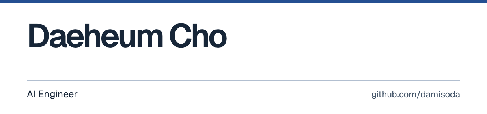

미국문화를 공부하다 AI 서비스 개발을 시작했습니다. 모델의 해석을 실행 규칙으로 옮기고, 근거와 서비스 동작을 코드로 확인합니다.

**[웹 포트폴리오](https://damisoda.github.io/)** / [포트폴리오 PDF](https://damisoda.github.io/portfolio.pdf) / [이력서 PDF](https://damisoda.github.io/resume.pdf) / [이메일](mailto:jodaeheum800@gmail.com)

## 대표 프로젝트

### [돌아오길](https://damisoda.github.io/projects/come-back-home/)

보호자의 설명과 시민 제보를 수색 구역에 반영하는 서비스입니다. 개발 팀장으로 모델 역할 분리, LoRA 학습과 서빙, 배포 후 운영을 맡았습니다.

혼란도 평가에서 만점이 나와 채점 경로를 확인했습니다. 서비스 규칙이 보정하기 전의 모델 응답을 다시 채점하니 정확도는 **75%**, 항상 ‘중’으로 답하는 기준은 **88%**였습니다. 혼란도 계산에는 기존 규칙을 유지하고, 두 점수를 함께 표시하도록 평가기를 바꿨습니다.

[평가 보고서](https://damisoda.github.io/projects/come-back-home/#validation) / [앱 실행 검증](https://damisoda.github.io/projects/come-back-home/#rules) / [GitHub](https://github.com/Donghaeng-AI-ROOKIE/Come-back-home)

### [Dev-Hive](https://damisoda.github.io/projects/dev-hive/)

흩어진 AI 활용 사례를 주제와 선행관계로 묶어 다음에 읽을 글을 추천하는 서비스입니다. 팀 리드로 그래프 편입과 추천 흐름을 설계했습니다.

글마다 주제가 생겨 비슷한 자료가 흩어졌습니다. 기존 주제에 먼저 편입하고 남은 글을 군집화하도록 바꾸자, 콘텐츠 924건의 DB 재구축에서 자동 생성 주제가 **825개에서 24개**로 줄었습니다. 별도의 시간순 유입 실험에서는 동적 임계값으로 1패스 미편입 건수를 **717건에서 534건**으로 줄였습니다.

[2패스 편입](https://damisoda.github.io/projects/dev-hive/#two-pass) / [동적 임계값](https://damisoda.github.io/projects/dev-hive/#threshold) / [GitHub](https://github.com/damisoda/Dev-Hive)

### [커리어 저금통](https://damisoda.github.io/projects/career-piggybank/)

입금이 불규칙한 긱워커에게 예산 배분을 제안하는 생활금융 데모입니다. Expo, FastAPI, 로컬 EXAONE을 연결하고 제안과 원장 승인까지 구현했습니다.

모델의 성향 점수가 인용한 거래 근거와 반대 방향이면 코드가 탐지해 한 번 교정하고, 재실패하면 판단을 보류하도록 했습니다. 합성 페르소나 13명의 라벨 22개를 평가한 결과 **방향 오류는 0건**이었고, 교정 도입 실험의 정확도는 68.2%, 같은 평가의 규칙 기준은 90.9%였습니다.

[판독 검증](https://damisoda.github.io/projects/career-piggybank/#validation) / [예제 데이터 데모](https://damisoda.github.io/demos/career-piggybank/) / [GitHub](https://github.com/Geek-Sogang/Career-Piggybank)

## 인턴십

**[LearnCraft](https://github.com/LearnCraftOrg/LearnCraft)**, 샤이닝라이언, 2026.03 - 2026.04

난이도별 문항을 배분하고 생성 응답이 검증에 실패하면 오류를 전달해 한 번 교정하도록 했습니다. Python과 SQL 답안은 Judge0로 실행해 기대 출력과 비교했습니다.
