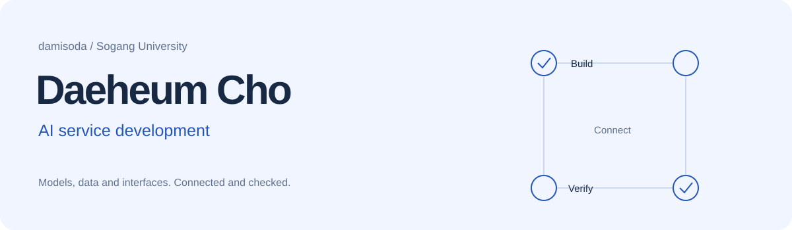
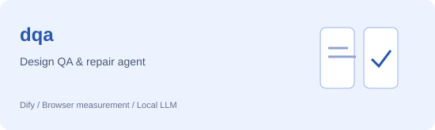
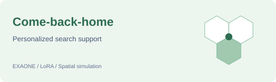
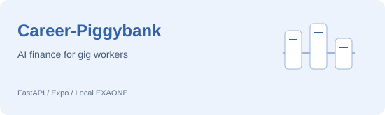
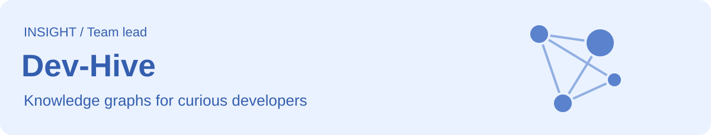
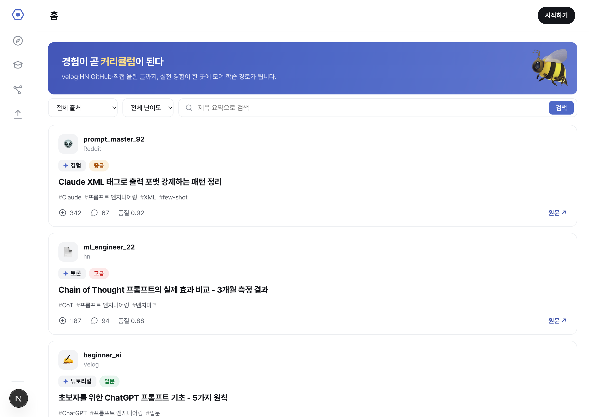

<picture>
  <source media="(prefers-color-scheme: dark)" srcset="assets/header-dark.svg">
  
</picture>

<h1 align="center">언어에서 출발해, 사람이 쓰는 AI 서비스로.</h1>

   
  <strong>안녕하세요, AI 서비스 개발자를 꿈꾸는 조대흠입니다.</strong> 
  서강대학교 미국문화 전공 · 인공지능 연계전공

  
  

## 🌱 조금 더 소개하면

언어를 공부하다가, 언어를 이해하고 행동하는 AI에 관심을 갖게 됐습니다.
지금은 **모델이 사용자 화면과 만나 실제로 도움이 되는 서비스**를 만들고 싶습니다.

실종자 수색 지원, 긱워커의 생활금융, 개발자의 학습 경로처럼 서로 다른 문제를 다뤄왔습니다.
요즘은 **AI가 만든 화면을 다시 검사하고 고치는 에이전트**를 만들며,
“만들었다” 다음에 오는 “제대로 동작하는가”를 배우고 있습니다.

AI 코딩 도구와 함께 요구사항을 구체화하고, 구현을 개선하고, 실행 결과를 확인합니다.
궁금한 것은 직접 만들어보고, 그 과정에서 배운 것을 다음 프로젝트로 이어가고 있어요.

## 대표 프로젝트

<h3>dqa · AI가 만든 화면, 다시 확인하기</h3>

Figma 시안과 구현 화면의 차이를 측정하고, 모델이 코드를 고치면 여러 화면 크기에서 다시 검사하는 도구입니다.

<strong>결과</strong> — 결함 보고 2건 → 0건 · 검사부터 수정·재검증까지 중앙값 143.8초 → 98.8초 (통제 사례, 전후 각 3회)

<strong>함께 진행한 일</strong> — Dify를 반드시 거치는 실행 흐름, Figma 자동 연결, 실제 검사 로그와 수정 전후 화면 등 요구사항을 구체화하고 AI와 함께 수정·재검증했습니다.

  
  
  
  

<a href="https://github.com/damisoda/design-qa-agent">저장소</a> · <a href="https://damisoda.github.io/projects/design-qa-agent/">프로젝트 이야기</a> · <a href="https://github.com/damisoda/design-qa-agent/blob/main/docs/performance-20261021.md">반복 실행 기록</a>

실행 결과 더 보기

동일한 글자 넘침 사례를 전후 각 3회 실행했을 때, 전체 실행 시간 중앙값은 <strong>143.8초 → 98.8초</strong>였습니다. 화면 크기 5개를 유지한 한 통제 사례의 결과입니다.

 

<h3>돌아오길 · 누군가의 귀가를 돕는 AI</h3>

보호자가 들려준 생활사와 수색 통계·도로망으로 위치 확률지도를 만들고, 필요한 구역의 시민에게 제보를 요청하는 수색 지원 서비스입니다.

<strong>결과</strong> — 정답 위치 포함률 52.78% → 63.00% · 면적당 효율 +28.18% (본선 대비 최종안, 합성 인물 39명 시뮬레이션) · <a href="https://huggingface.co/Damisoda/EXAONE-Dementia-SAR">SAR LoRA 어댑터 공개</a>

<strong>함께 진행한 일</strong> — 생활사 해석을 위한 모델 비교, SAR·K-EXAONE·RAG의 연결 방식, 개인화·마음모델·보행 코드의 개선 방향을 논의하고 AI와 함께 실험 설계·수정·검증을 진행했습니다.

🏅 <strong>2026 인공지능 루키대회 1차 결선 진출</strong> · 팀 동행

  
  
  
  
  
  

<a href="https://github.com/Donghaeng-AI-ROOKIE/Come-back-home">저장소</a> · <a href="https://damisoda.github.io/projects/come-back-home/">프로젝트 이야기</a>

대회 결과와 검증 범위

1차 결선까지 진출했으며 2차 결선에는 진출하지 못했습니다. 대회 활동은 종료되었습니다.
실제 실종 사건에서의 발견 성능을 검증한 서비스가 아니라, 시뮬레이션과 모델 비교 실험을 진행한 프로젝트입니다.

 

<h3>커리어 저금통 · 불규칙한 수입에도 계획이 생기도록</h3>

긱워커의 커리어 기록·예산 배분·은퇴 준비를 연결하는 AI 생활금융 프로젝트입니다.

<strong>결과</strong> — 골든셋(13 페르소나·22개 축)에서 방향오류 0건 · 판단 역할 10개에 가드레일·폴백 · 외부 AI API 없이 로컬 EXAONE만 사용

<strong>함께 진행한 일</strong> — 앱의 탭 구성과 데모 사용자 흐름, 로컬 모델 사용 조건을 정하고, AI와 함께 디자인을 백엔드에 연결하고 봉투 UI·미션·레벨업 경험을 개선했습니다.

🏆 <strong>하나 청년 금융인재 양성 프로젝트 우수상</strong> · 팀 짱사이트

  
  
  
  

<a href="https://github.com/Geek-Sogang/Career-Piggybank">저장소</a> · <a href="https://damisoda.github.io/projects/career-piggybank/">프로젝트 이야기</a> · <a href="https://damisoda.github.io/demos/career-piggybank/">데모 체험</a>

 

<h3>Dev-Hive · 다음에 무엇을 배울지 막막할 때</h3>

기존 Next.js 프런트 실행 화면 · 저장소 예제 데이터 사용

흩어진 AI 콘텐츠를 수집·태깅하고 지식그래프로 묶어, 관심사와 수준에 맞는 학습 콘텐츠를 추천하는 개발자 학습 커뮤니티입니다.

<strong>결과</strong> — 고아 노드 비율 94% → 3.3% (그리디 v1 → 2패스 재설계) · 그래프 coverage 0.91 · 6종 소스 1,283건 수집·가공

<strong>맡은 일</strong> — 팀 리드로 그래프(Layer 2)와 서비스 영역을 맡았습니다. AI와 함께 FastAPI API·온보딩·서비스 통합을 진행하고, 로컬 모델 활용과 그래프 고도화 방향을 검토했습니다.

🐝 <strong>서강대학교 INSIGHT 학회 프로젝트</strong>

  
  
  
  
  
  

<a href="https://github.com/damisoda/Dev-Hive">저장소</a> · <a href="https://damisoda.github.io/projects/dev-hive/">프로젝트 이야기</a> · <a href="https://insight.oopy.io/8a312ab9-7d49-49c3-95e2-bf2ad786af2c">학회 소개</a>

구현 상태 더 보기

GraphSAGE는 학습 파이프라인까지만 구축했으며 추천에는 반영하지 않았습니다.

 

## 🧩 다른 실험과 경험

| 프로젝트 | 어떤 것을 다뤘나요? |
|---|---|
| [**Paper-Digest**](https://github.com/damisoda/Paper-Digest) | arXiv 논문 수집 → 로컬 요약 → Obsidian·Discord 아카이빙 |
| [**LearnCraft**](https://github.com/damisoda/LearnCraft-quiz_generator) | 인턴십 프로젝트 · 강의 스크립트 기반 퀴즈 생성·자동 채점 |
| [**LOVELOP**](https://github.com/damisoda/LOVELOP-commercial-agent-simulator) | 생성형 에이전트의 상권 의사결정과 전략 전후 비교 시뮬레이션 |
| [**text-recovery**](https://github.com/damisoda/text-recovery) | 자모 분리와 KoBART를 활용한 한국어 텍스트 복원 |
| [**Paw Patrol Network**](https://github.com/damisoda/TECH4GOOD_Hackerthon) | 산책 중 보도·점자블록 파손 탐지와 민원 문안 생성 |
| [**godscore-demo**](https://github.com/Geek-Sogang/godscore-demo) | XGBoost·SHAP 기반 긱워커 대안신용평가 데모 |

## 🛠️ 프로젝트에서 만난 기술

**모델과 에이전트**

**서비스와 데이터**

## 📚 활동과 발자취

| 기간 | 활동 | 역할·결과 |
|---|---|---|
| **2026.03–현재** 2026.12 종료 예정 | [서강대학교 경영데이터사이언스학회 INSIGHT](https://insight.oopy.io/) | **15기** · Dev-Hive 팀 리드 · 세션 진행 |
| **2026.07** | 하나 청년 금융인재 양성 프로젝트 | 🏆 **우수상** · 커리어 저금통 |
| **2026** | 인공지능 루키대회 | 🏅 **1차 결선 진출** · 돌아오길 · 활동 종료 |
| **2026.03–04** | 멋사 로켓단 인턴십 | LearnCraft |
| **2025.12–2026.02** | 멋쟁이사자처럼 AI NLP 3기 | NLP·생성형 에이전트 팀 프로젝트 |
| **2026** | SKT × 하나금융 TECH4GOOD 해커톤 | Paw Patrol Network 출품 |
| **2022–2026** | 서광회 60기 | 동아리 활동 |

INSIGHT에서 데이터 분석·ML/DL을 공부하며 프로젝트와 세션 활동을 이어가고 있습니다.

활동 정보의 공식 출처

[INSIGHT 공식 회원 명단](https://insight.oopy.io/ecbeedca-f6b1-40aa-b6e4-990ab94179e1) · [학회 프로젝트 소개](https://insight.oopy.io/8a312ab9-7d49-49c3-95e2-bf2ad786af2c) · [하나 프로젝트 수상 기록](https://insight.oopy.io/a87f8c6b-2a84-4478-9c67-626820a4ec29)

## 📊 꾸준히 쌓는 중

<picture>
  <source media="(prefers-color-scheme: dark)" srcset="https://github-profile-summary-cards.vercel.app/api/cards/profile-details?username=damisoda&theme=tokyonight">
  
</picture>

## 🐾 코딩하는 동안 자라는 친구들

